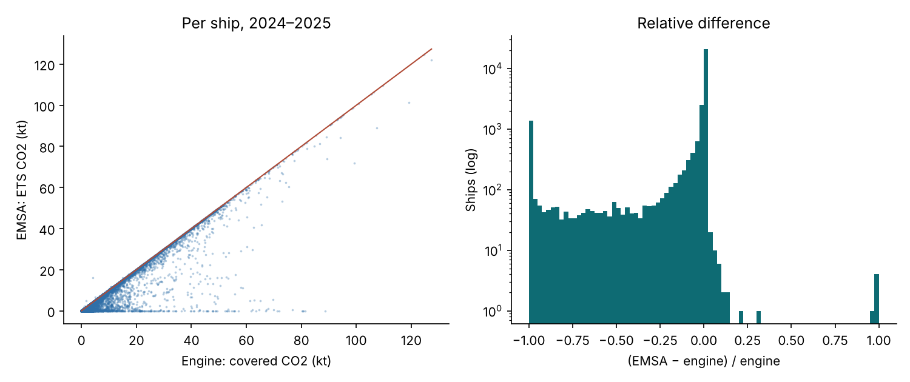

# EU ETS engine against EMSA's published ETS emissions

Data: EU MRV public emission reports, full-year reports, 2024 v253 (2026-10-23), 2025 v72 (2026-10-24).

Engine rule: 100% of CO2 on voyages between EU ports and within EU ports (the larger of the 'at berth' and 'within ports' figures), 50% on voyages to or from a non-EU port. Compared before phase-in.

| Year | Ships | Exact (±0.1%) | Within ±5% | Exact, ships with EMSA > 0 | EMSA lower | EMSA higher | EMSA = 0 |
|---|---|---|---|---|---|---|---|
| 2024 | 14,185 | 86.6% | 89.9% | 87.2% | 12.4% | 1.0% | 1.9% |
| 2025 | 17,409 | 78.5% | 84.0% | 81.0% | 21.4% | 0.0% | 5.8% |

Fleet total: engine 194.75 Mt CO2, EMSA 176.22 Mt CO2 (EMSA -9.5%).

## By ship type (both years)

| Ship type | Ships | Exact | Within ±5% |
|---|---|---|---|
| Bulk carrier | 9,355 | 92.1% | 93.6% |
| Chemical tanker | 3,097 | 80.6% | 86.8% |
| Combination carrier | 15 | 93.3% | 93.3% |
| Container ship | 4,535 | 71.9% | 80.9% |
| Container/ro-ro cargo ship | 136 | 85.3% | 89.0% |
| Gas carrier | 787 | 92.2% | 94.3% |
| General cargo ship | 4,396 | 76.7% | 80.8% |
| LNG carrier | 763 | 94.0% | 95.9% |
| Oil tanker | 3,991 | 88.2% | 91.4% |
| Other ship types | 850 | 83.4% | 86.7% |
| Other ship types (Offshore) | 612 | 79.9% | 81.4% |
| Passenger ship | 245 | 43.3% | 68.6% |
| Passenger ship (Cruise Passenger ship) | 225 | 32.4% | 60.9% |
| Refrigerated cargo carrier | 257 | 88.7% | 90.7% |
| Ro-pax ship | 856 | 58.3% | 65.4% |
| Ro-ro ship | 472 | 76.5% | 79.9% |
| Vehicle carrier | 1,002 | 65.9% | 74.3% |

## Global warming potentials

CO2eq = CO2 + 28·CH4 + 265·N2O holds within 0.01 t for 100.0% of 28,318 ship-years that report both gases.

## Interpretation

Where EMSA's figure is lower, the likely causes are route-specific rules the engine does not model from annual totals: the island and outermost-region derogations (ro-pax and passenger ships) and the treatment of calls at neighbouring container transshipment ports (container ships). Ships with an EMSA figure of zero are mostly outside the ETS: general cargo ships of 400–5,000 GT and offshore ships, both added to EU MRV in 2025 (offshore ships enter the ETS in 2027). About 100 bulk carriers a year also show zero without an evident reason; they are left unexplained. For past years the application therefore uses EMSA's reported figure; the rule is used for projections and for ships without reported data.

